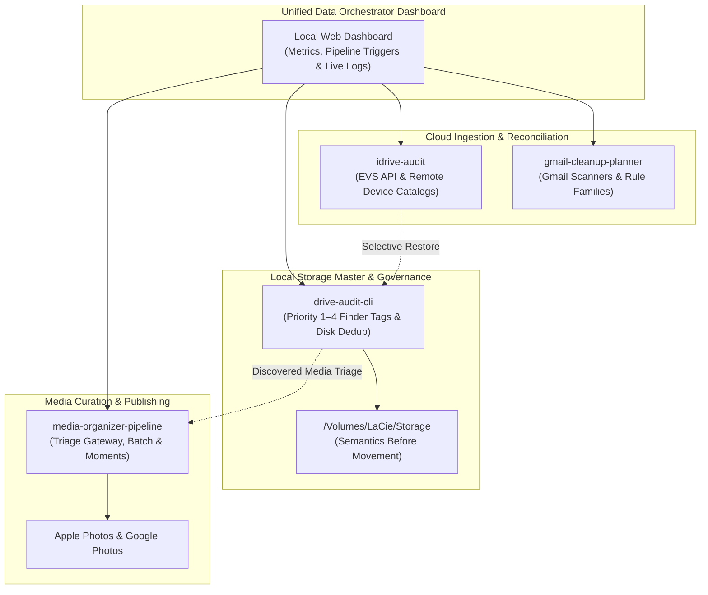

# 🌐 Data Orchestrator

A central command center, unified web dashboard, and orchestration wrapper managing the multi-pillar ecosystem for personal data governance, storage auditing, media curation, and cloud reconciliation.

---

## 🏛️ Component Architecture

`data-orchestrator` brings together four specialized systems:



---

## 📦 Submodule Ecosystem

| Pillar | Repository | Primary Scope | Core Databases / Files |
| :--- | :--- | :--- | :--- |
| **Media Curation** | [`media-organizer-pipeline`](https://github.com/nickolaycohen/media-organizer-pipeline) | Ingest, triage, Apple Photos, AI curation, Google Photos sync | `media_organizer.db`, `triage_media_intake.py` |
| **Storage Master** | [`drive-audit-cli`](https://github.com/nickolaycohen/drive-audit-cli) | Physical disk audits, Finder color sync, Priority 1–4 governance | `drive_audit.db`, `shared_storage_rules.db` |
| **Cloud Backups** | [`idrive-audit`](https://github.com/nickolaycohen/idrive-audit) | Remote EVS tree indexing, local vs cloud reconciliation | `device_registry.db`, `idrive_audit.db` |
| **Mail Governance** | [`gmail-cleanup-planner`](https://github.com/nickolaycohen/gmail-cleanup-planner) | Gmail cleanup planning, rule family grouping, mailbox hygiene | `token.json`, `planner-report.py` |

---

## 🚀 Getting Started

### 1. Clone with Submodules
```bash
git clone --recurse-submodules https://github.com/nickolaycohen/data-orchestrator.git
cd data-orchestrator
```

### 2. Environment Setup
```bash
# Python backend & CLI dependencies
python3 -m venv .venv
source .venv/bin/activate
pip install -r requirements.txt

# Web Dashboard frontend dependencies
npm install
```

### 3. Launch Dashboard
```bash
npm run dev
# or unified launcher:
./run.sh
```
